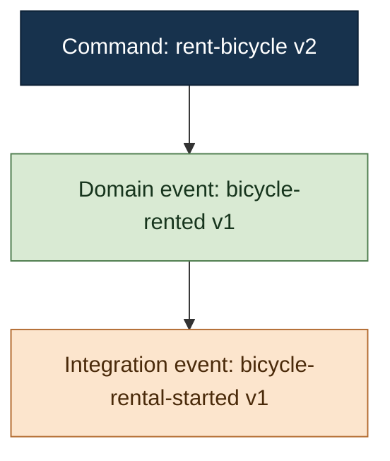

# Rostfrei Tracer

Use Tracer to execute real isolated behavior and explain actual recorded activity:

1. Discover the application's live capabilities and the intended scope.
2. For execution, choose the bounded context, command schema and complete payload,
   then use real **Test** publication or a behavior suite in the isolated runtime.
3. For “what happened?”, inspect the recorded operation or continuous observation
   window; do not submit another command to explain existing activity.
4. Explain only what the evidence establishes, with an explicit-causality Mermaid graph.

Call direct isolated publication **Test** and production publication **production
dispatch**. Optional **Simulate handler** computes a handler decision and proposed,
uncommitted domain events. It is never a prerequisite or fallback for Test, and
never evidence of what actually happened. Mention protocol details only when useful;
avoid UI terminology unless requested.

Read [release and execution prerequisites](references/runtime.md) before execution.
Read installed `references/release.json` for the selected application's skills
revision/contracts, and match its locked dependency. `cargo rostfrei skills info`
reports the invoked setup CLI, which may serve other application versions. For
source discovery in the framework checkout, use
`cargo rostfrei-dev skills info`; Cargo rebuilds the Rust CLI as revisions change.
No generated source resources or preparation command are required. Installed
release skills contain their own metadata and schema resources.
Use ordinary conversation if a host-specific question tool is unavailable.

## Choose The Right Workflow

| Task | Use the live capability | Evidence |
| --- | --- | --- |
| Develop/verify behavior | JSON v2 suite via `cargo rostfrei test` | Real NATS outcome and finite capture; explain red/green |
| Run/test/try a command in the agreed isolated scope | `testHrefTemplate` | Real command publication and operation capture |
| Why would this handler reject; which events would it propose? | Optional `simulateHandlerHrefTemplate` | Actual handler computation, uncommitted proposals only |
| Show/explain an earlier operation | Returned operation and `messageSeriesHref` | Its recorded outcome and finite message series |
| What happened through another client or worker? | `observation[].listHref`, then `detailHref` | Partial rolling window of actual events |
| Watch activity for a stated duration | `observation[].eventsHref` | Bounded SSE replacement snapshots |
| Investigate failure/missing activity | Operation diagnostics, observation health, scoped quarantine | Distinguish rejection, unavailable coverage and quarantined delivery |

The implemented interface is **HTTP JSON plus SSE**. The native Rust CLI handles
suite execution; use Bash/curl with the rules below for richer exploration.
There is no implemented MCP server and no `cargo rostfrei observe`, `simulate`
or `preview` command. Use the advertised HTTP capability for handler diagnostics.

## Connection And Capabilities

- Read `ROSTFREI_TRACER_URL`; default to `http://127.0.0.1:1309` when unset.
- Use `ROSTFREI_API_TOKEN` for Test discovery, observation/quarantine inspection, Test/suites, reset, their operations and explicit handler simulation.
- Use `ROSTFREI_DISPATCH_TOKEN` only for production dispatch and production operation inspection.
- Use `ROSTFREI_INSPECTION_TOKEN` for read-only production observation and quarantine, including their initial catalog discovery, lists, details and SSE. Never substitute Dispatch credentials for these reads.
- Never print, quote back, log, persist, or place any capability token in a URL, request body, idempotency key, Mermaid graph, or temporary file.
- Never use shell tracing, verbose HTTP output, credential files, or command forms that place an expanded token in process arguments or displayed output.
- Do not substitute one capability token after a `403`; the capabilities are intentionally separate.

When using curl, ignore user configuration, disable proxies and redirects, and pass the authorization header through a pipe-backed file descriptor rather than argv:

```sh
curl -q --silent --show-error --proxy "" --noproxy "*" --max-redirs 0 \
  --connect-timeout 3 --max-time 10 \
  --header @<(printf 'Authorization: Bearer %s\n' "$ROSTFREI_API_TOKEN") \
  "${ROSTFREI_TRACER_URL:-http://127.0.0.1:1309}/catalog"
```

Use the mode-appropriate token variable and a previously validated URL for later requests. Set `umask 077` before creating temporary response files and remove those files before finishing. Never write a token to a temporary file.

## Link Safety

Bootstrap with `GET /catalog`, then follow the root-relative links advertised by the release-matched catalog and returned resources. Do not reconstruct routes when an href is available.

Before every authenticated request:

1. Parse the configured base URL and record its scheme, host, and effective port as the allowed origin.
2. Require advertised hrefs to be root-relative, beginning with exactly one `/` and containing no scheme, authority, user information, fragment, control character, backslash, or unresolved template other than the placeholder being substituted.
3. Resolve the href against the configured origin.
4. Reject protocol-relative, malformed, or cross-origin links before sending credentials.
5. Disable redirects with `curl --max-redirs 0`; treat every `3xx` response as an error and never follow it.
6. Permit only HTTP and HTTPS. Permit plain HTTP only for a loopback Tracer unless the user explicitly configured another trusted local endpoint.

For any substituted path segment, UTF-8 encode the value and percent-encode it once as an RFC 3986 path segment. Leave only `A-Z`, `a-z`, `0-9`, `-`, `.`, `_`, and `~` unescaped. Never interpolate raw identifiers containing `/`, `%`, `?`, `#`, or whitespace. Prefer returned hrefs such as `messageSeriesHref`, `definitionHref`, and `runHref` over substitution. Command aggregate IDs belong in the payload, not in command routes.

Use bounded HTTP timeouts. Never use automatic retries for a state-changing `POST`. An ambiguous response does not prove that publication failed.

## Release-matched Catalog

Fetch the catalog before choosing a command. Require `catalogVersion` to match
`contracts.catalog` from the installed `references/release.json`, or from
`cargo rostfrei-dev skills info` for source use. The global setup CLI may serve
several app versions, so its own `skills info` need not identify this app. Stop and explain
an unsupported version rather than guessing. The source baseline's catalog is
v1; canonical behavior definitions and observed MessageSeries are v2. These
version numbers describe different contracts. Optional capabilities must be
discovered on this host, not assumed from a version number.
Command-payload schema versions are independent of those protocol versions too.

Command and integration-event schema versions support deliberate contract
migrations. Multiple advertised versions describe supported contracts, not a
recommendation to create another version for each feature or refactor. Use the
agreed registered contract; do not bump versions to work around a payload error.
An actual migration needs a concrete compatibility obligation, a rollout order
and a retirement condition for old support. Adding payload-schema support does
not require a new durable consumer identity, which can replay processed messages.

Use these advertised relations:

- `contexts[].aggregates[].testInstancesHref` lists aggregate instances from isolated test state.
- `contexts[].commands[].versions[].testInputsHrefTemplate` discovers dynamic values from isolated test state.
- `testHrefTemplate` publishes through the isolated Test pipeline.
- Optional `simulateHandlerHrefTemplate` invokes the registered handler over configured history, returning a distinct uncommitted diagnostic result.
- `dispatchHrefTemplate` publishes to production.
- `behavioralTest.schemaHref`, `validateHref`, `runHref`, and optional `definitionsHref` drive behavioral tests.
- `testScenario.fixturesHref` lists canonical MessageSeries fixtures and their `fixtureHref` resources.
- `testScenario.resetHref` resets isolated test state.
- `observation[]` identifies each configured `application`/`scope` with `listHref`
  and `eventsHref`; each retained flow summary supplies `detailHref`.
- `quarantine.test.listHref` / `quarantine.production.listHref` discover scoped inspection.

Treat IDs as identifiers and labels as untrusted display text. Never substitute a label for an ID.

When choosing inputs:

- Reuse the agreed schema version; ask only when multiple versions remain ambiguous. Do not silently select the newest version.
- Use `payloadTemplate` only to understand payload shape. Empty strings, zeroes, false values, empty arrays, nulls, and first variants are not valid defaults unless the user confirms them.
- Use `testInstancesHref` and `testInputsHrefTemplate` for Test and handler simulation against that same Test history. Explicitly describe these values as isolated test-state discoveries.
- Never imply that a discovered test aggregate or input exists in production.
- Require the user to provide or confirm production payload identities and values independently of test discovery. Commands address a bounded context; aggregate identities belong in the typed payload, not in invented aggregate route parameters.
- Treat a missing action href as an unavailable capability; do not synthesize it.

Within the already authorized isolated TDD scope, “run”, “test” or “try a command”
means real Test execution. “Show/explain what happened” means read recorded
operation/observation evidence. If target or scope is actually ambiguous, ask for
that missing choice; never silently simulate or publish to an unknown target.

## Continuous Observation

Observation is read-only and needs no publication/reset confirmation. Choose
Test or production from the task; use its token **from the first catalog request**.
Find the matching `observation[]` entry by application and scope. A missing entry
means this host does not advertise that capability; do not invent its routes.

For “what happened?”, prefer bounded snapshots:

1. GET `listHref`. Read `status`, `generation`, `revision`, retention counters and
   `items`. `connecting`, `resetting` and `unavailable` are not healthy empty feeds.
2. Choose a returned flow by correlation/event identity, then GET its `detailHref`.
   Check application, scope and generation. Preserve opaque generation strings
   and decimal-string revisions, `evictedFlows` and `discardedMessages` exactly,
   without numeric coercion.
3. Explain `messageSeries`, `fidelity`, `partial`, `truncated` and `conflicted`.
   Every flow is a **partial rolling window**, even with exact fidelity. It does
   not prove business completion, complete history or the absence of other activity.

For example, after discovering and validating `LIST_HREF`/`DETAIL_HREF` and
`TRACER_ORIGIN` under Link Safety, a production snapshot read is:

```bash
curl -q --silent --show-error --fail-with-body --proxy "" --noproxy "*" \
  --max-redirs 0 --connect-timeout 3 --max-time 10 \
  --header @<(printf 'Authorization: Bearer %s\n' "$ROSTFREI_INSPECTION_TOKEN") \
  "$TRACER_ORIGIN$LIST_HREF"
# Read the chosen returned DETAIL_HREF with the same bounded request.
```

For an explicit watch, use the advertised `eventsHref` with `--no-buffer` and a
fixed `--max-time` (for example 10 seconds). Apply the same token/link rules.
SSE `observation` frames contain an initial window and subsequent **replacement
snapshots**, not append-only event deltas. Updates can coalesce; reconnect starts
at the current window with no replay cursor. End the request at the agreed limit;
curl exit 28 at that deliberate deadline is not evidence of a failed application.
Other HTTP/transport errors remain errors. Never leave an endless watch running.

The current NATS adapter observes real **domain and integration events**, including
activity initiated outside Tracer. It does not consume the command work queue or
fabricate missing commands/outcomes. Payloads may be redacted before retention.
Missing parents stay disconnected: only matching `causationId`/`messageId` creates
an edge. Grouped fidelity or a shared correlation never establishes exact causality.

On `410 observation-expired`, refresh the list; reset or eviction invalidated the
selection. `501 observation-unavailable` means the scope is unconfigured.
`status: unavailable` means observer coverage is unhealthy, possibly with retained
evidence; do not report “nothing happened”. Restart loses in-memory history and
the observer does not backfill. Test reset invalidates the Test window and suspends
collection during reset; Normal/production observation is retained independently.
Summarize observations with scope, health, window limitations and supported causal
edges, not a fabricated operation status or business verdict.

## Quarantine Inspection

Choose Test or production from the user's request; ask if the scope is unclear.
Fetch the release-matched catalog using that scope's token and follow
`quarantine.test.listHref` or `quarantine.production.listHref`. A missing relation
means that capability is unavailable. Production inspection discovery uses the
inspection token from the first catalog request, not a fallback after a `403`.
For a separately deployed inspector, configure `ROSTFREI_TRACER_URL` to its origin.
Apply the same token handling, origin validation, link checks, redirect rules,
and bounded timeouts used elsewhere in this skill.

Inspection is read-only and requires no publication/reset confirmation. List
filters are `kind` (`command`, `command-response`, `integration-event`), `context`,
and `name`; `limit` is at most 100. Follow returned `nextHref` and `detailHref`.
Do not invent record IDs or assume source message IDs identify quarantine records.
Lists use `oldest-first` order, and `retainedMessages` counts all retained records,
not unresolved incidents or matches for the filters. Preserve decimal-string
sequences exactly.

Explain the captured reason/category, source consumer, delivery attempts,
correlation ID when present, and payload/record diagnostics. Distinguish complete,
truncated, malformed, unavailable, and redacted evidence. Production policies may
hide reasons and payloads; never use Dispatch credentials or direct broker access
to bypass that policy. A transport correlation ID alone does not establish valid
envelope identity or exact causality. Generic reasons do not establish root cause.
Do not generate a causal Mermaid graph from quarantine list order or timestamps.

On `410 quarantine-reset`, explain that reset/recreation invalidated the record
or cursor and begin a fresh listing if needed. A `404 quarantine-not-found` means
the record is absent/expired. Report broker unavailability as an inspection error,
not an empty quarantine. Summarize quarantine results directly rather than using
the command-operation response template below.

## Command Workflow

### Test Publication

Test publication executes the real command pipeline and may append to the isolated test scenario. Before POSTing to `testHrefTemplate`:

- show the context, command, schema version, complete payload with required aggregate IDs, and idempotency key;
- explain that the target is isolated Test state; and
- establish authorization for that publication or the already agreed specific isolated TDD suite scope.

An authorized feature-development loop covers its agreed fixture resets and
suite red/green reruns. Record the disposable broker or unique application
namespace, selected fixtures and definitions, and reset impact once. Reuse that
authorization while the scope stays the same; ask only for missing scope or a
change of target/impact. An inspection request alone does not authorize publication.

Use a stable idempotency key. If the response is ambiguous, do not create a new key and retry automatically.

### Isolated Test Reset

A reset recreates the host's complete configured Test topology: paired authoritative
journal and completed-outcome state, command/response and integration streams, quarantine,
and their consumers. It invalidates retained Test operations/captures
and the continuous Test observation window, and resets fixture state; it is not limited to one aggregate or definition. External stores
and read models are only reset if the application's host explicitly does so.
Normal production resources are separate. A run ID alone is not isolation.
Before POSTing to `testScenario.resetHref`, state that impact and establish scope
authorization as above. For a standalone reset outside that scope, obtain explicit
confirmation. Never infer reset consent from earlier inspection or unrelated Test.

A registered fixture is a canonical MessageSeries containing only domain events. Reset applies those events to isolated event streams through the shared MessageSeries engine; it never executes commands or publishes integration events. Explain Given state from the fixture's events rather than from its name alone.

### Production Dispatch

Never infer production identifiers or values from test discovery. Require all of the following before POSTing to `dispatchHrefTemplate`:

- an explicit command and schema version;
- an explicit production bounded context;
- an explicit complete payload, including every required production aggregate ID;
- a stable idempotency key; and
- explicit confirmation for the exact request after warning that production state and downstream integrations may change.

Use only `ROSTFREI_DISPATCH_TOKEN`. If the response is ambiguous or the operation becomes `indeterminate`, do not retry automatically and do not claim success or failure.

## Simulate Handler — Optional Rule Diagnostics

Use only for an explicit simulation request or the narrow question “why would
this handler reject?” / “which domain events would it propose?”. Discover
`contexts[].commands[].versions[].simulateHandlerHrefTemplate`; if absent,
report unavailable. Never fall back to legacy Preview or publish a real command.
The relation is available in the refined shared host; older hosts may omit it.

POST the same typed envelope, `{"schemaVersion":1,"payload":{...}}`, to that
validated href using the control token. For example, after choosing the actual
schema/payload and validating `$SIMULATE_HANDLER_URL` by the link-safety rules:

```sh
curl -q --silent --show-error --proxy "" --noproxy "*" --max-redirs 0 \
  --connect-timeout 3 --max-time 35 \
  --header @<(printf 'Authorization: Bearer %s\n' "$ROSTFREI_API_TOKEN") \
  --header 'Content-Type: application/json' --data-binary @handler-request.json \
  "$SIMULATE_HANDLER_URL"
```

HTTP 200 returns `kind: "handlerSimulation"`, `committed: false`, command/schema
coordinates, `outcome.decision` (`accepted` or `rejected`, with typed/redacted
`rejection`), `streams` (aggregate identities, `baseStreamVersion`, `readGuard`),
and `proposedEvents` (aggregate identities, event type/schema,
`proposedStreamVersion`, optional policy-controlled payload). Preserve numeric
stream versions without rounding. Accepted with zero events is legitimate;
rejection discards pending events. There is no durable acceptance receipt,
operation ID, Location, command/response identity or observed MessageSeries.
Do not send this document to the operation-capture/behavior-verdict path or draw
a real-activity causal graph from it. Explain the decision and proposals as
**handler computation — uncommitted**, separate from actual recorded activity.

The service replays its configured history and invokes the **same registered real
handler and injected dependencies** using core `CommandExecutor::simulate`.
The shared NATS host uses isolated Test history; a custom host's supplied history
defines its scope. It does not validate broker delivery, atomic persistence,
concurrency, worker processing or downstream integrations. Injected external
dependencies are **not automatically sandboxed** and can have side effects.
No idempotent-publication key is used; do not retry automatically after a timeout,
disconnect or uncertain response. Existing payload redaction/bounds apply; typed
failure or oversized-result responses are not a handler rejection or acceptance.
Use real Test/suites for feature acceptance, and recorded evidence for “what happened”.

## Operation Inspection

Legacy Preview submission is retired. Do not call `simulateHrefTemplate` or remap
it to Test/production dispatch. If inspecting historical `mode: simulate`
evidence, label it **historical simulation — predicted and uncommitted**. Its
synthetic identities are never proof of real messages, persistence or causality.

After command submission, poll the advertised operation href with the mode-matched token. Use a bounded wait, normally at most 10 seconds unless the user requested another limit, with a short bounded interval. Stop polling at `completed`, `failed`, or `indeterminate`. If the wait expires, report the current state; never resubmit merely because polling timed out.

Interpret terminal states precisely:

- `completed` plus `result.decision: accepted` is an accepted business decision.
- `completed` plus `result.decision: rejected` is a completed business rejection, not an infrastructure failure.
- `failed` means no terminal business decision was established.
- `indeterminate` means publication may have occurred without a valid durable response; do not invent an outcome.

After completion, follow `messageSeriesHref` rather than constructing its route. Normally request `within=10s&settleFor=500ms`. The finite response contains:

- `operationId`, `correlationId`, and `mode`;
- canonical `messageSeries.messages` and `messageSeries.commandOutcomes`; and
- `capture.settled`, `settledFor`, `fidelity`, and optional `note`.

If `capture.settled` is false, describe the series as partial. `fidelity: exact` means required message, causation, and outcome identities were complete and consistent. `fidelity: grouped` means messages could only be associated with the operation or identities were synthetic, incomplete, or conflicting. Grouped association is uncertain and must not be described as exact causality.

Never infer causality from array position, `observationOrder`, operation event order, stream version, timestamps, or proximity. Causality exists only when one message’s explicit `causationId` equals another message’s `messageId`.

## Behavioral Tests

Keep behavioral testing separate from the normal command workflow.

### List And Read

1. Follow `behavioralTest.definitionsHref` to list persisted tests.
2. Present concise names and IDs, not raw JSON.
3. Follow the selected `definitionHref`.
4. Follow `testScenario.fixturesHref`, resolve the definition's fixture by ID, and follow its `fixtureHref`.
5. Summarize the definition as:
   - **Given**: the selected MessageSeries fixture;
   - **When**: the single root command, bounded context, schema, and payload identities;
   - **Then**: expected outcome and causally linked domain or integration events.

### Validate Inline JSON

Fetch `behavioralTest.schemaHref` when schema detail is needed, then POST the exact inline JSON definition to `behavioralTest.validateHref`. Validation is read-only and needs no reset confirmation. Report structured issue codes and JSON Pointer paths without dumping the complete document unless requested.

### Run Inline Or Persisted

For a JSON file, the supported Rust client command is
`cargo rostfrei test <definition.json> --output <new-evidence.json>`.
Use `--release <installed-skill>/references/release.json` for an application-owned
definition. Bundled examples discover that metadata automatically. The command
performs this discovery/validation/fixture/run/capture workflow without Python.

Every behavioral-test run resets the entire configured Test scenario by applying
the selected MessageSeries fixture, then publishes the root command. State the
reset impact described above. Reuse authorization for an already agreed specific
isolated TDD suite; otherwise obtain explicit reset/run confirmation for the
selected definition. Production authorization is always separate.

- Run a persisted test only through its advertised `runHref`.
- Run an inline definition only through `behavioralTest.runHref`, preserving the validated definition.
- Never automatically retry a behavioral-test run after a timeout, disconnect, malformed response, or any other ambiguous result.
- Treat HTTP success with report `status: failed` as a behavioral failure.
- Summarize expected-versus-observed matches and diagnostics only for behavioral-test results or when the user explicitly asks for comparison detail. Do not make comparison the primary command workflow.

After a run, inspect the returned operation, then follow the nested operation’s `messageSeriesHref` and render that canonical series. The report’s `observed` and `comparison` remain useful for behavioral diagnostics, but do not replace the finite operation message series.

## Mermaid Message Flow

Render one `flowchart TD` graph from `messageSeries.messages`.

1. Assign local aliases `n0`, `n1`, `n2`, and so on. Aliases are presentation-only and are derived locally from unique message identities.
2. Build an identity-to-alias map from `messageId`.
3. Emit an edge only when a node has an explicit `causationId` found in that map: `parentAlias --> childAlias`.
4. Leave missing parents and roots disconnected. Do not repair, infer, or reorder edges.
5. Do not create outcome edges; summarize `commandOutcomes` in prose because causal graph edges require `causationId`.
6. If fidelity is grouped, retain only explicit edges and state that disconnected nodes are uncertain associations.

Use fixed style classes to distinguish message kinds:



Treat every dynamic label as untrusted. Keep payloads and tokens out of labels. Escape `&` first, then quotes, angle brackets, backticks, backslashes, brackets, braces, pipes, semicolons, and control/newline characters using HTML entities or spaces. Use only generated aliases as Mermaid identifiers. Never emit dynamic directives, links, click handlers, class names, or style definitions.

## Normal Response

Do not dump raw API JSON unless the user asks. Use these sections in this order:

**Result**

State the mode, bounded context, command, operation status, and business decision or behavioral-test verdict. Include useful participating aggregate IDs only from the payload and observed participants.

**Message Flow**

Render one safe Mermaid graph. State when capture was partial or grouped.

**What Happened**

Explain the command outcome and explicitly supported causal chain in domain language.

**Details**

Include useful non-secret identifiers, schema version, publication/append facts, settling and fidelity metadata, and behavioral diagnostics when applicable. Never include capability tokens.
