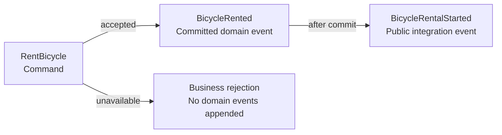

<p align="center">
  <picture>
    <source media="(prefers-color-scheme: dark)" srcset="https://raw.githubusercontent.com/elbLabs/rostfrei/main/packages/ui/src/brand/duck-dark.png">
    
  </picture>
</p>

<h1 align="center">rostfrei</h1>

<p align="center">
  <strong>A Rust framework for event-sourced applications.</strong>
</p>

<p align="center">
  <a href="https://elblabs.github.io/rostfrei/">Website</a> |
  <a href="https://elblabs.github.io/rostfrei/docs">Documentation</a> |
  <a href="https://elblabs.github.io/rostfrei/docs/getting-started">Getting started</a> |
  <a href="studio/README.md">Tracer Studio</a>
</p>

<p align="center">
  <a href="https://crates.io/crates/rostfrei"></a>
  <a href="LICENSE"></a>
</p>

**Build reliable systems with your coding agent. Focus on the business rules that matter.**

Event sourcing gives you a history you can replay, state you can reconstruct,
and new views of the facts you've already recorded. rostfrei handles durable
commands, atomic event transactions, messaging, and read models while your
business rules stay in ordinary Rust.

Work with your agent to turn those rules into features, run real behavioral tests,
and inspect the results with Tracer. Build with evidence you can both check.

## Use the framework

One dependency, with the adapters you need:

```toml
[dependencies]
rostfrei = { version = "0.2.3", features = ["nats", "tracer"] }
```

Install the development CLI separately:

```sh
cargo install --locked --version 0.2.3 rostfrei-structure
```

See [framework setup](docs/getting-started.mdx#one-framework-dependency) for
features, imports, and test dependencies. **0.2 APIs are evolving**;
read the [upgrade guide](docs/getting-started.mdx#upgrading-from-01) for existing applications.

## What you get

- **A checked domain model.** Declare bounded contexts, aggregates, and behavior.
  `cargo rostfrei check` validates ownership and project structure.
- **Durable decisions.** Commit events across aggregates in one atomic transaction.
  Exact retries recover the recorded outcome.
- **Messaging and HTTP.** Typed buses, NATS JetStream storage and delivery, and
  HTTP command and query routes.
- **Event-driven read models.** Saved query views with persistence, source
  checkpoints, and concurrency retries.
- **Tests you can inspect.** Given/When/Then scenarios run through the real,
  isolated NATS-backed pipeline. Explore the evidence with a coding agent or Studio.

## From command to history

The [bike-rental example](examples/bike-rental) handles a rental like this:



Replaying private domain events reconstructs aggregate state: history is the
source of truth. Separately versioned integration events share public contracts
after commit. The example also transfers bicycles between two fleets atomically.

## Explore with your agent

Copy this prompt into a coding agent with terminal access:

```text
Help me explore rostfrei through its bike-rental example. Use https://github.com/elbLabs/rostfrei and read docs/agent-tutorial.md from the checkout before setup. Check my environment, prepare an isolated local demo, and guide me through a successful rental and a rejection using real Tracer evidence. Explain one step at a time and let me choose what to inspect next. Use text by default; use a richer display only when its adapter is explicitly available.
```

The [tutorial](docs/agent-tutorial.md) uses Git, Rust, and NATS, usually through
Docker. Your agent checks prerequisites and guides each step; Studio is optional.
For ongoing work, [Agent Skills](docs/agent-skills-install.md) support test-first
development and runtime inspection.

## Documentation

| Explore | Start here |
| --- | --- |
| Model the business | [Domain macros](docs/domain-macros/index.mdx) and [project structure](docs/project-structure/index.mdx) |
| Run an application | [Command runtime](docs/command-runtime.md), [read models](docs/read-models/index.mdx), and [operations](docs/README.md#runtime-and-operations) |
| Browse the reference | [Shared documentation](docs/README.md) and the [machine-readable index](https://elblabs.github.io/rostfrei/llms.txt) |
| Understand the design | [Architectural maxims](docs/adr/README.md) and [release changes](CHANGELOG.md) |

## Contribute

Enable the structure-check and Clippy hook with `git config core.hooksPath .githooks`.
The [development guide](docs/development.md) covers tests, benchmarks, and releases;
see [website](website/README.md) and [Studio](studio/README.md) for frontend development.

## License

Copyright (c) 2026 elbtech.dev. Licensed under the [Apache License 2.0](LICENSE).
