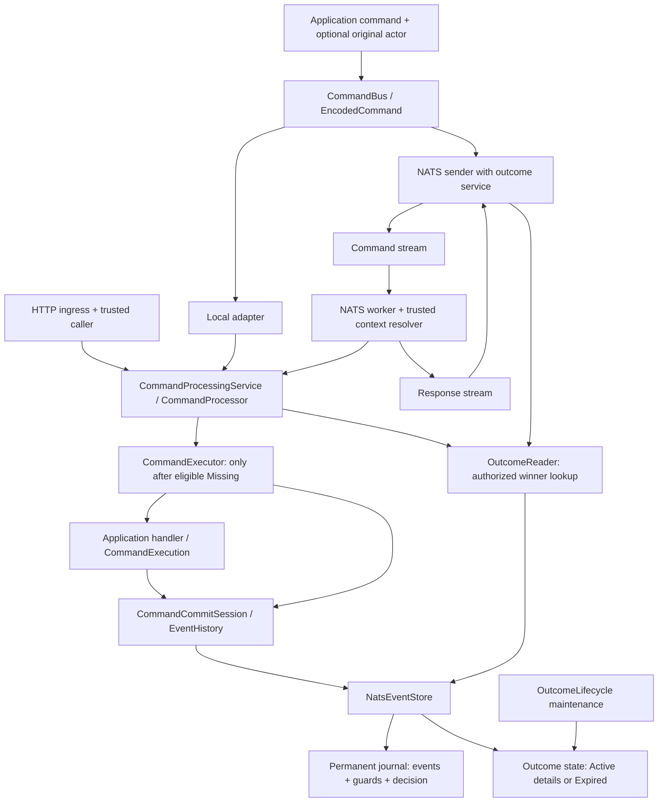

# Command runtime: stack, call map and consolidation checklist

**Reviewed/measured runtime checkpoint:** `27c571b2bf2452a6818020550886845db566c8ef`
in the original runtime lineage. Updated 2026-10-16.
The PR branch has been rebased onto current main; historical validation and
measurements remain attributed to their recorded source revisions below.

The modular runtime, `ExecutionStore` rename and actor foundation are implemented
and independently reviewed. Measurements at `95ce943` found substantial latency
regression and mixed storage costs. **The first bounded consolidation pass is now
implemented and independently reviewed at `27c571b`.** Affected checks and request
diagnostics pass; exact-build latency comparisons are complete. Primary no-read and
small-event paths improved in both run orders; other cases include unresolved timing
regressions. Four design reviews and the agreed scope are recorded in section 6.
Section 4 preserves pre-consolidation
accounting; the call paths describe the current implementation.

This is a runtime-only checkpoint. Combined Tracer/host/harness readiness requires
the separately owned service/reset/replay adaptations and final combined-candidate
qualification.

**0.1 release decision (2026-10-16):** the user accepts deferring interface-preserving
performance optimization until after 0.1. Further tuning, latency targets and the
remaining measurement program are **not release blockers**. The bounded first pass
already completed at `27c571b` preserves public interfaces and stored formats; its
results remain recorded below. This scheduling decision does not establish a latency
SLA or replace correctness and the other release checks.

## How to use this document

- [Stack](#1-stack-and-responsibilities): what each layer owns.
- [Call paths](#3-current-call-paths): where processing, reads and writes happen.
- [Request budget](#4-where-the-extra-nats-calls-come-from): why latency increased.
- [Completed work](#5-completed-work): implemented and verified changes.
- [Review outcome](#four-lens-review-outcome): recommendations and scope decisions.
- [Measured results](#measured-latency-and-disposition): milliseconds and the first-pass decision.
- [Consolidation checklist](#6-consolidation-checklist): proposed changes to check off.
- [Verification](#7-verification-and-review-log): evidence required for completion.

`[x]` means the stated work is complete at the recorded checkpoint. `[ ]` means it
is pending. When completing a consolidation item, record its commit, tests and
request-count change in the review log; a proposed design alone does not close it.

## 1. Stack and responsibilities

### Technology

- Rust 2024, pinned Rust **1.98.0**; Tokio async runtime.
- Serde/JSON envelopes and default codecs; application-provided codecs are supported.
- `async-nats` **0.50.0** for NATS/JetStream; validation and measurements used owned
  **NATS 2.12.15** instances, except separately documented older Docker test fixtures.
- Axum **0.8** for the optional HTTP ingress.
- `InMemoryEventStore` and `NatsEventStore` implement the coordinated storage contract.

### Runtime layers

| Layer | Main types / crate | Responsibility | Where external work happens |
| --- | --- | --- | --- |
| Application | Domain command, handler, aggregate | Decide business behavior; establish authenticated caller at ingress | Application-defined work |
| Message construction | `CommandRequest`, `CommandBus`, `EncodedCommand` / `rostfrei` | Encode command, identity, route, correlation and optional actor; select transport adapter | Dispatch through the selected adapter |
| Message vocabulary | Envelopes, addresses, `ActorRef` / `rostfrei-messaging-core` | Shared wire/metadata types and validation | No broker work by itself |
| Local / HTTP ingress | `InMemoryMessagingAdapter`, `context_command_router` | Validate delivery and supply trusted caller context to the service | HTTP receives requests; persistence depends on the service's store |
| Native transport | `NatsMessagingAdapter`, `NatsCommandHandler` / `rostfrei-nats` | Publish commands, consume deliveries, reconcile/publish responses and admit results | Command, response and quarantine JetStream operations |
| Processing service | `CommandProcessingService`, `CommandProcessor` / `rostfrei` | Route, authorize, look up completed results, invoke execution and project results | Calls storage; optional authorizer/audit providers may perform I/O |
| Execution engine | `CommandExecutor`, `CommandExecution` / `rostfrei-core` | Run handler, track aggregate reads/writes, form proposal, reconcile winner and retry conflicts | Calls session/history/storage ports |
| Coordinated persistence port | `ExecutionStore`, consuming `CommandCommitSession` / `rostfrei-core` | Commit events, read guards and permanent decision through one coordinator | Implemented by memory or NATS |
| Native persistence | `NatsEventStore`, `NatsAppendSession` / `rostfrei-nats` | Check authority, load history, prepare details, atomic journal commit and checked restoration | JetStream metadata requests, message reads and publications |
| Lifecycle maintenance | `OutcomeLifecycle` | Explicitly expire details for an exact winning revision | Native state CAS and retained-message reclamation check |

**Transport and persistence are independent choices.** An in-process adapter or HTTP
request can execute against `NatsEventStore`. The benchmark's “direct command” is a
direct service invocation with NATS persistence, not a memory-only benchmark.

Arrows show dependencies, not the complete temporal ordering. The ordered paths below
include authorization, commit verification and final admission. The diagram depicts
the configured authorized profile; trusted compatibility entry points are described
alongside those paths.

### Source map

| Start here | Important symbols |
| --- | --- |
| [Command bus](../../crates/rostfrei/src/command_bus.rs) | `CommandRequest`, `EncodedCommand`, `CommandBus::encode`, `dispatch` |
| [Service contract](../../crates/rostfrei/src/command_service.rs) | `TrustedCommandContext`, `CommandAuthorizer`, `CommandProcessingService`, `ProcessedCommand::admit` |
| [Processor implementation](../../crates/rostfrei/src/command_bus/processing.rs) | `authorized_lookup`, `process_authorized`, `execute_missing`, `project_commit` |
| [Executor](../../crates/rostfrei-core/src/executor.rs) | `execute_completed_with_rejection_codec`, `lookup_completed`, `CommandExecution::load` |
| [Persistence ports](../../crates/rostfrei-core/src/execution_store.rs) | `ExecutionStore`, `OutcomeReader`, `CommandCommitSession`, `OutcomeLifecycle` |
| [Native outcome coordination](../../crates/rostfrei-nats/src/event_store/outcomes.rs) | `verify_authority`, `lookup_outcome`, `begin_command`, `commit_native`, `prepare_details`, `read_state`, `matches_checked_receipt`, `expire_details` |
| [Native history/commit implementation](../../crates/rostfrei-nats/src/event_store.rs) | `require_completed_outcome_writer`, `load_transaction_receipt_materialized`, `append_transaction_with_histories`, `publish_atomic_messages` |
| [Native sender and worker](../../crates/rostfrei-nats/src/messaging_adapter.rs) | `dispatch`, `authorized_response`, `NatsCommandHandler::handle`, `reconcile_completed` |
| [Local adapter](../../crates/rostfrei/src/in_memory_messaging.rs) | `with_service`, `dispatch_as` |
| [HTTP ingress](../../crates/rostfrei-http/src/context.rs) | `context_command_router`, `submit` |
| [Shared codecs](../../crates/rostfrei-core/src/codecs.rs) | `AggregateCodecs` |
| [Actor type](../../crates/rostfrei-messaging-core/src/actor.rs) | `ActorRef` |

## 2. Identities and stored data

### These identities have different jobs

| Value | Meaning |
| --- | --- |
| `OperationId` | Stable identity of the business operation; reuse it for retries/replay |
| Command fingerprint / message ID | Bind the original command's content and metadata |
| `PrincipalId` | Current authenticated caller or worker |
| `SecurityScope` | Trusted scope bound to the original completion; not another operation namespace |
| `ActorRef { namespace, id }` | Optional original attribution; retained across replay by another caller |
| `CommandAuthority` | Configured storage namespace/epoch and captured stream incarnations |
| `OutcomeKey` | Authority + bounded context + operation |
| `OutcomeRevision` | Opaque identity of the exact winning outcome, used by lifecycle maintenance |

Actor is a claim checked by the configured ingress/policy, not a credential. Missing
actor means unknown. Changing actor or scope cannot turn an existing operation into
a new executable one. See [actor attribution](actor-attribution.md).

### Storage boundaries

| Data | Location | Lifetime / authority |
| --- | --- | --- |
| Domain events, transaction read guards, compact decision manifest | Permanent journal | Authoritative history and winning decision; survives detail expiry |
| First-completion details and encoded rejection body | Separate outcome-state stream, `Active` | Recoverable full-result data; indefinite by default, explicit expiry available |
| Terminal lifecycle evidence | Same state subject, `Expired` | Replaces Active by observed-sequence CAS; prevents reopening the completed operation |
| Commands awaiting workers | Command transport stream | Delivery backlog, separate from completion authority |
| Published responses / technical diagnostics | Response transport stream | Projections/transport evidence; cannot independently override a durable winner |
| Quarantined deliveries | Quarantine transport stream | Operational repair evidence |
| Attempt audit records | Configured audit sink | Optional, bounded awaited best effort; independently retained |

The **two mandatory persistence streams** are journal + outcome state. Transport
streams are additional and have different jobs. Native commits use atomic journal
batches and a separately prepared detail record; these are not one cross-stream
transaction. A prepared detail record alone is never a completed command.

## 3. Current call paths

### A. Fresh command through the processing service

This is the normal policy-enabled path. Local/HTTP ingress converges here; a native
worker invokes it after delivery checks. Direct low-level executor callers enter at
step 4 and are trusted infrastructure rather than authorization endpoints.
Context-aware local/HTTP integrations use this service path; the contextless local
compatibility path calls the trusted processor API instead.

1. **Ingress / service validation.** Validate original envelope and route, establish
   `TrustedCommandContext`; service optionally emits an audit Started record.
2. **`CommandProcessor::authorized_lookup`.** Authorize `ReadOutcome`, bind trusted
   scope, call `OutcomeReader::lookup_outcome`. A known winner takes the replay path.
3. **Only on eligible `Missing`:** authorize `Execute`, select the registered binding
   in `execute_missing`, then invoke the executor.
4. **`CommandExecutor::execute_completed_with_rejection_codec`.** Perform its own
    `lookup_completed`, then `ExecutionStore::begin_command`. The separate lookup also
    serves direct executor callers and every optimistic retry. Awaited Execute
    authorization separates it from the processor's observation: another invocation
    may have completed during that wait.
5. **Handler evaluation.** `CommandExecution::load` reads through the session, shared
    codecs rehydrate aggregates, and tracking collects events and read guards.
    Rejections and no-event acceptances retain the guards for successful reads.
6. **Consume session.** `CommandCommitSession::commit_outcome` validates the captured
   incarnation, then calls native `commit_native`. The session cannot be committed twice.
7. **Stage transaction.** `append_transaction_with_histories` checks for an existing
   winner, validates participants/versions and constructs events/guards/receipt.
8. **Prepare details.** `prepare_details` calls `publish_state` using raw subject CAS0,
   then `read_state` to verify the exact prepared bytes/reference and reconcile ACK
   uncertainty. Neither operation grants winning status.
9. **Win the permanent decision.** `publish_atomic_messages` commits events, guards
   and manifest to the journal with subject expectations. Batch publications are
   awaited in order; this protocol was already present in the baseline.
10. **Verify publication.** Extend/read histories, materialize the committed receipt,
    check batch coordinates and compare the same checked receipt/marker using
    `matches_checked_receipt`. Recovery paths still reload through `matches_stored`.
11. **Reload full outcome.** `commit_native` calls `lookup_outcome` again, restoring the
    marker and reading current lifecycle/details. Return `CompletedCommit`.
12. **Return admitted result.** Executor checks the returned authority/identity;
    processor projects the response and optionally audits Finished. Local/HTTP/native
    boundaries use `ProcessedCommand::admit` before exposing the response.

The executor owns optimistic conflict retries. On a conflict it looks for a winner
first; only eligible unresolved conflicts reach `ConflictRetryPolicy`. Disabling
reevaluation does not disable duplicate protection or exact completed replay.

### B. Native sender / worker additions

This describes the **configured authorized profile**: sender `with_outcome_service`
and worker `command_handler_with_resolver`. `NatsMessagingAdapter::new` alone has no
outcome service; `command_handler` selects the trusted compatibility processor.
Those contextless APIs and raw response readers are trusted infrastructure, with
different admission guarantees. See [native profiles](modular-command-native.md).

1. Sender `NatsMessagingAdapter::dispatch` validates the command and calls
    `authorized_response`: authorize and consult current outcome authority first.
2. If completed and readable, return that exact winner **without queueing or invoking
   a worker**. Completed but unreadable takes recovery/error handling. Only on Missing
   publish the command and wait for its response.
3. Worker `NatsCommandHandler::handle` validates delivery, resolves trusted caller
   context and acquires a local same-message execution gate.
4. Worker checks retained transport responses. A retained business response requires
   matching authoritative completion; technical diagnostics have separate retry/
   quarantine/recovery handling. With no retained response, continue to the service.
5. When processing is needed, worker executes path A, publishes the result and
   acknowledges successful delivery; a reconciled retained response can return
   earlier. Transport/publication failures follow the existing retry/quarantine protocol.
6. After receiving a response, the sender performs a fresh authorized winner lookup
   and returns that verified winner. A business response without authoritative
   completion is blocked. A transport response is not a permit to bypass expiry.

Sender, worker and service are distinct boundaries. Evidence from before queueing
cannot automatically certify storage or lifecycle after an arbitrary delivery delay.
An injected `CommandProcessingService` owns authorization, configured-authority
validation and lifecycle consultation. Adapter `admit` checks validate its returned
structure and binding; they do not independently establish that service's backend.

### C. Replay and recovery

`lookup_outcome` verifies the journal, reads/materializes the permanent receipt and
reads current state for the exact winning reference. Available details are checked
against the marker before projection. Actor/scope/request binding is checked too.

- `Missing` in an intact eligible authority may permit execution.
- Completed + available details returns the original result without running a handler.
- Completed + expired, corrupt, missing or unavailable details remains completed;
  it produces a typed recovery result/error, never new evaluation.
- `ProcessedCommand::admit` performs local result-binding checks. It does not itself
   fetch native lifecycle state; the native service/adapter must do that consultation.

**Freshness means an observation at the stated boundary.** Metadata INFO and later
GET/publication are separate broker requests. A verified handle is not an incarnation
lease. Native state is read before awaiting a configured detail provider; Finished
audit can also be awaited before the service returns. Expiry can occur after the
state read. The current contract does not promise atomic revocation at wall-clock
return; stronger admission timing would be a separate contract change.

### D. Explicit detail expiry

`expire_details(key, revision)` verifies authority and exact winner, reads state,
CAS-replaces Active with Expired, and reconciles the terminal state. It separately
checks absence of the old retained sequence before reporting `Reclaimed`; otherwise
reclamation can be `Pending`. Permanent history, decision and actor remain available.

## 4. Where the extra NATS calls come from

`async_nats::jetstream::Context::get_stream()` performs `STREAM.INFO`; it is not a
free local handle lookup. `verify_authority()` fetches the journal and state streams
sequentially and checks their configuration and captured incarnation bindings.
It now returns the checked state handle for the immediate reader to reuse.

The historical accounting below explains the problem found at `95ce943`. A “message”
is work sent to NATS while processing **one command**, not milliseconds or a stored
domain event. The implemented pass reduces the illustrated totals to **29 and 40**;
section 6 records the executed counter checks separately from latency measurement.

### Example: successful no-event acceptance, no aggregate reads

Policy-enabled direct service, healthy native store, fresh operation, no conflicts,
default detail reader and actor absent. Measured total outbound-message counts are
14 historical baseline / 40 before consolidation. The stage breakdown is source-path
accounting. A later headers-only diagnostic trace at `95ce943` independently confirmed
the API-family totals; it does not measure per-function elapsed time.

| Stage | Baseline `050f086` | Pre-consolidation `95ce943` | Pre-consolidation implementation |
| --- | ---: | ---: | --- |
| Processor + executor absence lookups | 6 | 10 | Two `lookup_outcome` calls; each fetches journal metadata twice, reads the receipt, then checks the pair |
| Session opening + commit fencing | 3 | 9 | `begin_command`, session incarnation check, `commit_native` |
| Check existing transaction receipt | 2 | 2 | `load_transaction_receipt_inner` |
| Prepare details + read-back | 0 | 7 | `publish_state` + `read_state` |
| Publish journal decision | 1 | 1 | One-message atomic batch in this no-event case |
| Verify published receipt/proposal | 2 | 4 | Materialization followed by another lookup in `matches_stored` |
| Reload completed outcome | 0 | 7 | Final `lookup_outcome` inside `commit_native` |
| **Total** | **14** | **40** | |

That pre-consolidation healthy path accounts for **30 stream INFO requests, eight message reads
and two publications**. Many waits are serial. The client counter counts outbound
messages, not every protocol operation, network packet or network roundtrip.

For **one event on one previously missing aggregate**, the measured count rose from
20 to 56: **35 INFO + 12 message GETs + three persistence publications + six history
consumer operations** (two creates, two pulls, two deletes). Two extra history
reconstructions follow the already-checked publication. Existing longer histories
can require more work; 56 is not a universal one-event budget.

Pre-consolidation native sender/worker operations add transport and admission work: fresh accepted-event
totals were 32–40 baseline / 89–91 pre-consolidation in the first round, including variable
worker/poll tail. Modular exact native replay short-circuits at the sender's authority
lookup (seven no-read / 12 one-event messages). Baseline native replay used three
messages through transport-response retrieval, with weaker admission semantics.

### Repetition addressed by the first pass

- `begin_command` and `commit_native` now rely on the full pair check already performed
  by writer validation, rather than immediately repeating it.
- `read_state` uses the state handle obtained by that invocation's pair check.
- `lookup_outcome` passes its verified journal handle to the receipt reader. The
  subsequent pair check after Missing still establishes execution eligibility.
- Publication verification compares its materialized receipt directly. The complete
  final `commit_native` outcome lookup, with fresh lifecycle consultation, remains.
- Processor/executor initial lookups overlap, but the executor must also remain safe
  as a standalone entry point and observe completions after awaited authorization.
  The reviews recommend retaining these separate observations initially.

Measured new-command median ratios were 1.61–3.44× baseline directly and 1.26–3.28×
through native transport. The comparison used `actor=None`; audit was disabled and
authorization was an in-process policy. Request counts and code paths identify
concrete overhead, but no per-function profile apportions all elapsed time. The
shared-host response-publication-only control also slowed despite unchanged counts.

## 5. Completed work

- [x] **R1 — Modular execution contracts:** `ExecutionStore`, `OutcomeReader`,
  consuming commit sessions and separate lifecycle; one executor owns conflict retry.
- [x] **R2 — Processing service:** explicit trusted caller context, ReadOutcome before
  lookup, Execute only after absence, checked local/HTTP result admission.
- [x] **R3 — Native persistence:** permanent journal + Active/Expired state, exact
  preparation/commit recovery, sender admission and independent history reads.
- [x] **R4 — Native repair review:** captured authority survives metadata changes;
  paired state loss cannot yield execution-eligible Missing; read-only handles refuse
  all writes. Independent N1/N2/Q1 findings closed at `0a2d5ac`.
- [x] **R5 — Shared codecs and audit:** one effective immutable registry; optional
  bounded audit delivery is separate from business results and never reruns handlers.
- [x] **R6 — Naming:** `CommandBackend` renamed to `ExecutionStore` at `48034e0`.
- [x] **R7 — Actor foundation:** original actor bound into commands, durable events,
  decisions and supported integration helpers; explicit versioned formats and legacy
  actor-less compatibility. Implementation checkpoint `5353e02`.
- [x] **R8 — Independent review and regression retention:** product correctness
  approved; reviewer probes retained through final `95ce943`.
- [x] **R9 — Historical validation (`95ce943`):** 154-target union, 1,229 passing test
  executions, 21 accounted ignored entries; eight external-consumer tests and required
  tooling gates passed.
  Coverage combines 153 unchanged targets at `21cc526` with 47 executions in one new
  target at `95ce943`; counts include repeated imported controls. Final `27c571b`
  affected validation is recorded separately under C7.
- [x] **R10 — Measurements:** exact-final optimized build, two rotated baseline/
  candidate pairs and separate actor-profile runs completed; latency regression and
  mixed storage tradeoffs recorded.
- [ ] **R11 — Performance acceptance (post-0.1, non-blocking):** assess optimization
  results and any further work separately from release readiness. The user has
  accepted deferral of interface-preserving tuning; no numerical latency/SLA threshold
  has been agreed.

## 6. Consolidation checklist

### Four-lens review outcome

All four independent reviewers inspected runtime `95ce943` and the same draft on
2026-10-16. These were static reviews using existing evidence. They established
concrete redundant work and design recommendations, **not a new runtime defect or
new test/benchmark results**.

| Perspective | Main recommendation | Disposition for the first pass |
| --- | --- | --- |
| Fowler-style refactoring | Improve private helper return values; retain the checked receipt/marker together | C1/C2 plus a pure C3a comparison; preserve existing service/executor/session ownership |
| YAGNI | Use existing helpers and receipt types; keep the smallest useful scope | C3b deferred; retain supported profiles and public contracts |
| DDD / hexagonal | Keep native observations inside the persistence adapter and guards inside the attempt | Existing inbound/outbound ports retained; document identity and trust boundaries |
| Performance | Eliminate serial reacquisition before broader changes; trace each delta | Source targets below; C6 starts before and accompanies implementation |

The only material scope difference was **C3b**: DDD and Fowler identified checked
winner propagation as a useful follow-up; YAGNI and performance recommended measuring
the smaller pass first. The reconciled first pass is **C1 + narrow C2 + C3a**.
C3b remains deferred. Processor/executor and sender/worker lookups are intentionally
retained across authorization/delivery waits (C4/C5).

Optional later CPU work: parse the immutable command once within the processor,
avoid audit-only payload construction when audit is disabled, and decode a checked
native state observation once. Their benefit is unmeasured and outside this first
request-reduction pass.

**Implemented internal approach:** return validated stream handles from the stage
that obtained them, and pass checked receipt/marker data to the immediate comparison.
Such evidence describes an observation; it is not an indefinite lease on mutable
broker state. Handles remain private and call-local rather than cached on the store.

### Boundaries whose checks must remain explicit

| Boundary | What must be established |
| --- | --- |
| Original ingress | Valid command/route and authenticated caller; actor remains a separate claim |
| Execution eligibility | Authorized lookup and authoritative absence in the captured intact pair |
| Attempt/session | Same authority incarnation; valid tracked reads and proposal |
| Prepare/commit | Eligible writable authority, exact prepared reference, guarded atomic winner; no stale session adopting replacements |
| Completed-result admission | Exact authorized winner, identity/scope/actor, checked receipt and lifecycle consultation at the documented boundary |
| Expiry | Exact winning revision, terminal CAS transition and separate reclamation proof |

- [x] **C0 — Freeze the boundary/evidence handoff design.** Recorded in local
  `consolidation-pass-20261016/BOUNDARIES.md`: immediate native handle/checked-receipt
  reuse, captured incarnations and configuration, error kind/origin, retained later
  checks and focused fault probes. Distinguish immutable validation, checked committed
  evidence, mutable observations and per-invocation authorization.
- [x] **C1 — Consolidate adjacent pair checks.** Writer validation owns the complete
  pair check at session opening and `commit_native`; the immediate repeats are removed.
  Read-only policy and the separate session-incarnation fence remain. `27c571b`.
- [x] **C2 — Reuse verified stream handles.** Pass the journal/state handles into
  receipt/state readers within existing lookup stages. Keep the post-miss pair check,
  session fence, fresh publication/read-back and final lifecycle consultations.
  Preserve absence/configuration/incarnation error classification and freshness rules.
  Implemented and checked at `27c571b`.
- [x] **C3a — Compare already-checked publication evidence.** Extract a pure comparison
  against `MaterializedTransactionReceipt`, then reuse it in the confirmed-success
  branch. Preserve split proposal-digest and legacy fallback semantics, batch/guard
  integrity and fresh winner discovery on conflict/uncertain ACK. Keep the complete
  final `commit_native` outcome lookup. Implemented and checked at `27c571b`.
- [ ] **C3b — Propagate checked winner into final resolution (post-0.1, deferred).** Consider only
  after measuring C1/C2/C3a. Specify which final permanent-history observation changes,
  while keeping fresh lifecycle resolution and explicit recovery branches. A staged
  proposal or PubAck alone is insufficient evidence.
- [x] **C4 — Assess processor → executor lookup handoff.** Reviewed; retain the separate
  lookup after awaited Execute authorization, for standalone execution and retries.
  A winner can arrive during authorization. No handoff implementation is selected.
- [x] **C5 — Review native transport boundaries.** Reviewed; retain sender pre/post-wait
  and worker retained-response admission. The authorized/trusted profile distinction
  is recorded above. Native-store improvements apply within each actual lookup.
- [x] **C6 — Focused first-pass regression/request evidence.** Five new real-NATS cases
  exercise changed boundaries and classify outgoing request families; retained checks
  cover authority, guards, actor, corruption and uncertain ACK. Retained `95ce943`
  diagnostics cover all 18 harness cases, including an existing-history control;
  separate headers-only trace confirms baseline API totals. Full wait/CPU attribution
  and long-history profiling remain follow-up work if residual timings justify them.
- [ ] **C7 — Independent review and measurement closure (remaining performance work non-blocking for 0.1).** Review changed race windows,
  run affected checks, repin the harness and repeat the paired/actor measurements on
  the exact final candidate. Compare both `95ce943` → optimized and `050f086` → optimized.
   **Bounded substage complete:** independent review, 285 affected passing executions
   across 13 selected targets/selections, one accounted ignored diagnostic, strict
   workspace Clippy/fmt, exact-build smoke and two current95/optimized pairs.
  Historical050/actor repeats and broader residual-performance disposition remain
  follow-up work; the first-pass decision and observed regressions are below.

Implementation order was **C0 + C6 baseline → C1 → narrow C2 → C3a → C7**, with focused
C6 checks alongside every change. Remaining performance closure and further tuning
can follow 0.1; this sequence is not a release gate. C4/C5 close assessment decisions only.
The wire formats, caller/actor meaning and persistence guarantees established above
are the contracts against which consolidation is evaluated.

### First-pass request budgets

Same healthy-path assumptions as section 4; each row is cumulative. Replay columns
refer to the no-read / one-new-aggregate event fixtures. The current and final-pass
rows are now confirmed by actual request diagnostics; intermediate C1/C2 rows remain
source-derived estimates, not separately executed candidates.

| Checkpoint / proposed step | Fresh direct no-read | Fresh direct one-event | Completed replay no-read / one-event |
| --- | ---: | ---: | ---: |
| Before consolidation `95ce943` | 40 | 56 | 7 / 12 |
| C1: remove two adjacent pair checks | 36 | 52 | 7 / 12 |
| Narrow C2: reuse receipt/state handles | 31 | 47 | 5 / 10 |
| C3a: reuse materialized proposal comparison (`27c571b`, observed) | **29** | **40** | **5 / 10** |

Publications stay at two / three. C3a removes two messages without events and seven
with the tested event; the latter includes one consumer create/pull/delete cycle.
Fresh native totals need branch/tail accounting before an exact target is justified.

**Executed counter evidence:** retained `95ce943` diagnostics reproduce 40/56 and
7/12; a separate headers-only broker trace confirms their API families. The optimized
`native_consolidation` tests capture actual outgoing subjects and confirm **29/40
fresh and 5/10 replay**, unchanged publications/retained records and no replay handler
calls. Gated final-read expiry/state-loss and damaged-pair Missing tests also pass.
These diagnostics establish reduced work. Completed elapsed-latency comparisons are
reported below and retain their shared-host limitations.

**Proposed validation, not an agreed SLA:** prove these deltas with unchanged
publications/retained data and passing changed-boundary regressions; seek lower direct
no-read/one-event medians versus `95ce943` in both rotated pairs. Report all p95s,
native/replay results and residual historical regressions. Request reduction alone
does not establish latency improvement or performance acceptance.

### Measured latency and disposition

**Retain the bounded patch at `27c571b`.** Independent correctness review and affected
checks pass; request-work reduction is proven. The exact-build timing run supports
improvement for the two primary paths, while broader performance disposition remains
open under the release scheduling decision above.

Same harness/settings on both versions; two reversed run orders. Each direct case
has 90 analyzed new operations after ten warmups. Median is the middle observed
latency; p95 is the point at which approximately 95% of sampled operations finished.
All values below are milliseconds, with each pair kept separate.

| Pair | Direct command | Median before → after | p95 before → after |
| --- | --- | ---: | ---: |
| 1: current95 then optimized | No event / no aggregate reads | 153.067 → 78.189 | 619.648 → 186.654 |
| 2: optimized then current95 | No event / no aggregate reads | 170.523 → 86.472 | 580.086 → 219.688 |
| 1 | One new aggregate / 128-byte event | 229.721 → 86.368 | 560.918 → 167.197 |
| 2 | One new aggregate / 128-byte event | 237.760 → 86.142 | 693.953 → 165.532 |

All 18 workloads passed their behavioral assertions in smoke and both pairs:
6,400 new operations (720 warmups excluded from timing) and 1,440 exact replays,
plus separate smoke and maintenance checks. New-operation medians were lower in 31/36
case-pair comparisons; all six native new-command comparisons improved median and p95.
Encoded commands, responses, retained record categories/bytes and publication counts matched.

**Residual observations to keep visible:**

- Existing-history rejection reversed: pair 1 improved, but pair 2 median went
  155.041 → 283.191 ms; its replay also slowed.
- Larger-event results were mixed; pair 2 p95 went 491.302 → 774.718 ms.
- Four-guard replay cases with zero/large rejection bodies slowed in both pairs;
  some pair 2 new-operation tails reached about one second.
- Native event replay median increased modestly in both pairs even though its
  new-command path improved.

Host load ranged 7–23 on 16 available logical CPUs, and the unchanged response-only
control varied substantially. These observations do not isolate the causes of the
regressions or attribute the full improvements to this patch. They are neither a
production capacity forecast nor proof that the remaining regressions are only noise.

**Next performance step, when prioritized:** reproduce the residual history/guard/
replay cases in a quieter controlled run before selecting another optimization.
The full 72 comparison rows, raw samples and identities are in local
`consolidation-pass-20261016/measurement-prep/MEASURED-REPORT.md` and its linked artifacts.
These proposed performance criteria are follow-up evaluation criteria, not 0.1
release conditions, following the user's release-scope decision above.

## 7. Verification and review log

### Regression anchors

| Concern | Existing tests to preserve / extend |
| --- | --- |
| Consolidation race windows and classified request budgets | [native_consolidation.rs](../../crates/rostfrei-nats/tests/native_consolidation.rs) (five new cases; passing) |
| Paired authority, replacement, outage, read-only routes | [native_authority_regressions.rs](../../crates/rostfrei-nats/tests/native_authority_regressions.rs), [review_native_fixed.rs](../../crates/rostfrei-nats/tests/review_native_fixed.rs), [review_native_fixed_fresh.rs](../../crates/rostfrei-nats/tests/review_native_fixed_fresh.rs) |
| Native replay, lifecycle and failure protocol | [modular_native_contract.rs](../../crates/rostfrei-nats/tests/modular_native_contract.rs), [review_native_adversarial.rs](../../crates/rostfrei-nats/tests/review_native_adversarial.rs) |
| Original actor, identity, expiry, native result admission | [actor_contract.rs](../../crates/rostfrei/tests/actor_contract.rs), [actor_native_contract.rs](../../crates/rostfrei-nats/tests/actor_native_contract.rs), [review_actor_integrated.rs](../../crates/rostfrei-nats/tests/review_actor_integrated.rs) |
| Core result integrity, restored formats and lifecycle | [actor_integrity_contract.rs](../../crates/rostfrei-core/tests/actor_integrity_contract.rs), [review_native_restore.rs](../../crates/rostfrei-core/tests/review_native_restore.rs), [modular_outcome_lifecycle.rs](../../crates/rostfrei-core/tests/modular_outcome_lifecycle.rs) |
| Authorization, service replay and HTTP | [modular_service_contract.rs](../../crates/rostfrei/tests/modular_service_contract.rs), [modular_context_contract.rs](../../crates/rostfrei-http/tests/modular_context_contract.rs), [actor_policy.rs](../../crates/rostfrei-http/tests/actor_policy.rs) |

Changed boundaries should include replacement/loss between stages, stale already-open
sessions, concurrent winner/expiry, unavailable detail state, failed/uncertain ACKs,
exact replay with conflict retries disabled and successful healthy-path controls.
Keep original assertions and record any fixture-only adaptation explicitly.

### Progress log

| Item | State | Commit / proof | Requests or latency before → after |
| --- | --- | --- | --- |
| Reviewed runtime checkpoint | Complete | `95ce943`; R1–R10 above | Existing no-event acceptance 14 → 40 messages versus `050f086` |
| Stack/call inventory | Complete | This document, source inspection at `95ce943` | No-event 40 = 30 INFO + 8 reads + 2 publications, source-path accounting |
| Four-lens consolidation review | Complete; static review | Local `consolidation-review-20261016/` reports and reconciliation | First-pass targets 40 → 29 / 56 → 40; predicted at review time |
| 0.1 performance scheduling | User decision recorded, 2026-10-16 | Interface-preserving optimization may follow 0.1; correctness/release checks still apply | Further tuning and latency targets are non-blocking; no SLA implied |
| C0 boundary design | Complete | Local `consolidation-pass-20261016/BOUNDARIES.md` | Predictions retained until measured |
| C1 adjacent checks | Complete | `27c571b`; native writer boundary reused | Combined pass confirmed: 40/56 → 29/40 fresh |
| C2 stream handles | Complete | `27c571b`; immediate receipt/state handle reuse | Completed replay confirmed: 7/12 → 5/10 |
| C3a checked proposal comparison | Complete | `27c571b`; existing materialized receipt/marker reused | Final pass retains one event-history consumer cycle |
| C3b final checked-winner propagation | Deferred | Separate last-history-observation decision | Excluded from first-pass targets |
| C4 lookup handoff assessment | Complete; checks retained | Awaited authorizer and standalone/retry boundaries | No reduction selected |
| C5 native transport review | Complete; checks retained | Authorized/trusted profiles distinguished; delay/recovery boundaries retained | Savings inherit native-store changes |
| C6 focused regression/request budgets | Complete for bounded pass | 285 passing executions; five new boundary/count cases; baseline diagnostic/trace | Actual request deltas confirmed; no extra publications/retained records |
| C7 bounded substage | Complete; broader follow-up remains | Code review, 285 executions, Clippy/fmt and exact `27c571b` smoke/two rotated pairs | Primary medians/p95 improved in both pairs; residual history/guard/replay cases recorded |

### Local run evidence

The existing run artifacts are outside Git in the sibling directory
`../modular-runtime-refactor-evidence-20261015/` relative to the checkout root:

- `DELIVERY.md`: consolidated implementation/review/validation/measurement handoff.
- `ACTOR-CONTRACT-FREEZE.md`: approved actor and compatibility requirements.
- `review-actor-integrated/REPORT.md`: final independent product correctness review.
- `d3-actor-validation/REPORT.md`: full target inventory and external consumer results.
- `d3-final-review-import/REPORT.md`: final test-only source-equivalence proof.
- `accounting-final/REPORT.md`: exact-final benchmarks and limitations.
- `accounting-final/ACCOUNTING.md`: per-case traffic/storage and expiry accounting.
- `accounting-final/PAIRED-LATENCY.md`: both rounds' medians/p95s, including replay.
- `consolidation-review-20261016/RECONCILIATION.md`: four-review synthesis, scope and
  validation decisions; links to each independent report and handoff.
- `consolidation-pass-20261016/`: implementation boundary freeze, affected validation,
  independent acceptance tests/review and new measurement artifacts.
- `consolidation-pass-20261016/REPORT.md`: completed first-pass delivery and disposition.
- `consolidation-pass-20261016/VALIDATION.md`: 285 affected executions and exact check scope.
- `consolidation-pass-20261016/measurement-prep/MEASURED-REPORT.md`: all 72 absolute-ms
  comparisons, remaining regressions, exact identities and raw-sample locations.
- `consolidation-pass-20261016/RELEASE-DIRECTION.md`: latest user decision making
  remaining interface-preserving performance work non-blocking for 0.1.

These are local evidence locations, not published website links. New consolidation
results should receive a new evidence directory so the reviewed baseline remains
available for comparison.
